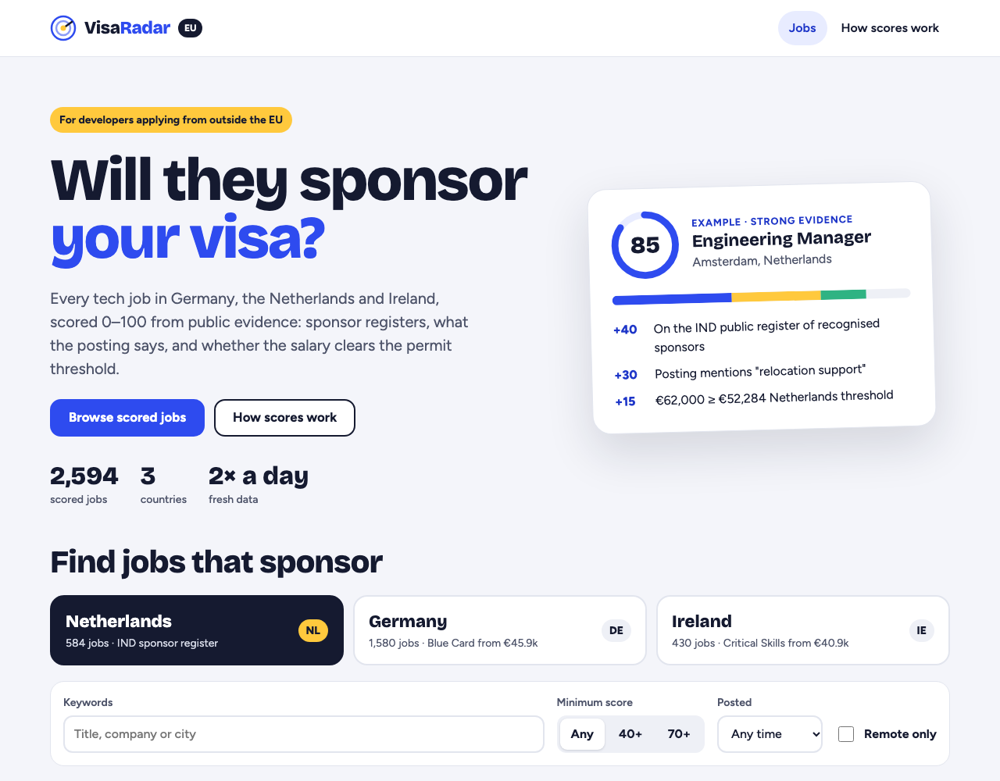
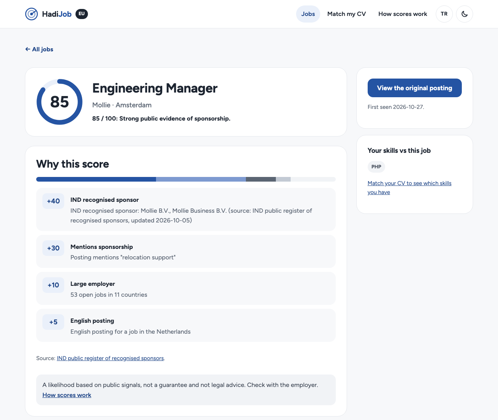
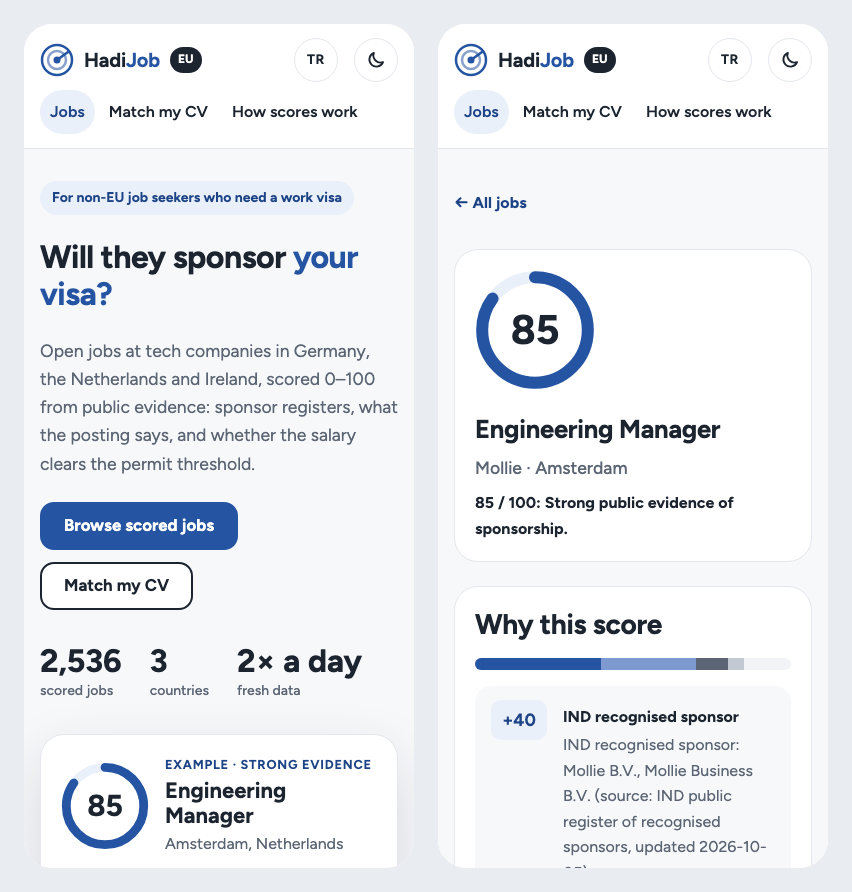
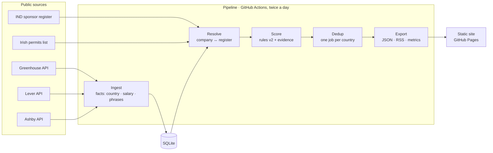

# HadiJob

**How likely is this EU job to sponsor your visa?**

Open jobs at tech companies in Germany, the Netherlands and Ireland, scored 0–100 for visa sponsorship, with the public evidence behind each score. In English and Turkish.

_"Hadi!" is Turkish for "come on, let's go"._

**[Try it →](https://ilker-ekin.github.io/visa-sponsor-radar-eu/)** (testing phase, feedback welcome)

<picture>
  <source media="(prefers-color-scheme: dark)" srcset=".github/assets/home-dark.png">
  
</picture>

> This repository is a showcase. The source code is private; I'm happy to walk through it in an interview or share it on request.

## The problem

People outside the EU lose weeks applying to roles that turn out not to sponsor visas. Job boards either ignore sponsorship or rely on what employers say about themselves.

HadiJob checks **public evidence** instead: government sponsor registers, what the posting itself says, and whether the salary clears the work-permit threshold. It turns that into a score you can read in a second and verify in a click.

## Features

- **Explainable scores.** Every point has a reason you can check: "IND recognised sponsor +40", "posting mentions a relocation package +30", "salary ≥ Blue Card threshold +15". No black box.
- **Official sponsor evidence.** The Dutch IND public register of recognised sponsors (13,000+ organisations) and the Irish list of employment permits issued to companies (9,000+ employers in the last 12 months), matched to employers with 100% precision on a hand-labelled set.
- **Reads the posting for you.** Sponsorship offers, relocation packages and "no sponsorship" rule-outs, with negation handled ("we do _not_ offer visa sponsorship").
- **Salary against real thresholds.** 2026 work-permit minimums for Germany, the Netherlands and Ireland, comparing base salary only (commission and deal sizes are ignored).
- **Built to scan, calm to read.** One accent colour and one typeface. Score tiles, evidence chips on every result, and a score ring with a bar showing how the points add up.
- **English and Turkish.** The language follows the visitor's region (Turkish in Turkey, English elsewhere) and can be switched in the header. Evidence lines are written from structured facts, so they read naturally in both languages.
- **Match your CV, privately.** Drop in an English PDF CV: it is read in your browser, never uploaded, and the skills found are compared with each job. Results rank by fit, and every job page shows which of its skills you have.
- **Search that stays shareable.** Filters live in the URL: country, keywords, minimum score, posting date, remote.
- **RSS alerts.** One feed per country and score level, with no account or email needed.
- **Fresh twice a day,** and redeployed within minutes of a merged change.
- **Light and dark.** Follows your system setting, with a toggle that remembers your choice.
- **Free, and no personal data.** No accounts, cookies or tracking. The only thing kept is your skills list, in your own browser.

## How it works

1. **Ingest:** about 135 company job boards are fetched politely. Each job gets its _facts_ at ingest time: country, remote, yearly salary, posting language and sponsorship phrases. Descriptions are never stored; anything derived from the text happens while it is in memory.
2. **Resolve:** each employer is matched to the IND register. Exact names link automatically, near-matches go to a review list, and human decisions are recorded in version control.
3. **Score:** versioned, explainable rules. A score starts at 0, adds each signal's weight and is clamped to 0–100.
4. **Dedup:** the same role posted in several cities of one country is shown once.
5. **Export:** JSON per country for the static site, RSS feeds and a metrics file. The site is built and deployed to GitHub Pages after every run.

Between runs, the SQLite database is kept as a release asset, so first/last-seen dates, ETags and closed jobs carry over. No server and no database server: it runs for €0.

### Scoring rules (v2)

| Signal                                                                      | Weight  |
| --------------------------------------------------------------------------- | ------- |
| Company is an IND recognised sponsor (NL jobs)                              | **+40** |
| Company was issued Irish employment permits in the last 12 months (IE jobs) | **+40** |
| Posting mentions visa sponsorship, relocation or the EU Blue Card           | **+30** |
| Posting rules out sponsorship / requires an existing right to work          | **−60** |
| Salary ≥ country threshold (DE €45,934 · NL €52,284 · IE €40,904)           | **+15** |
| Large company (≥ 50 open jobs in ≥ 2 countries)                             | **+10** |
| English posting in Germany or the Netherlands                               | **+5**  |

Scores are **likelihoods, not guarantees and not legal advice**.

## By the numbers

From a full pipeline run on 2026-11-03:

|                                    |                                                              |
| ---------------------------------- | ------------------------------------------------------------ |
| Job boards                         | **135** (Greenhouse 72 · Ashby 54 · Lever 9)                 |
| Open jobs processed                | **15,952**                                                   |
| Published (DE · NL · IE)           | **1,585 · 582 · 444**                                        |
| IND register entries               | **13,022**                                                   |
| Irish permits list                 | **9,345** employers (12 months to September 2026)            |
| Irish jobs with register evidence  | **323** of 444                                               |
| Employers with sponsor evidence    | **56** of 135                                                |
| Company matching (automatic rules) | **100% precision · 81.8% recall** on 100 hand-labelled pairs |
| Duplicate postings folded          | **1,190** into 655 roles                                     |
| Full refresh of all boards         | **75 s** (down from 37 min)                                  |
| Tests                              | **351**, plus an end-to-end smoke test                       |

## Engineering highlights

- **37 minutes to 75 seconds.** Per-board timing showed the time wasn't spent downloading: a few connections stalled for about 15 minutes each (3 attempts × the HTTP client's 300 s default timeout). A 30 s per-attempt timeout fixed the cause, and polling the three API hosts in parallel (still one request per second per host) removed the rest. The floor is now the rate limit itself.
- **Runtime-agnostic core.** The core package uses only web-platform APIs, so the same logic can move into a future API unchanged. Storage sits behind interfaces with shared contract tests for the in-memory and SQLite implementations.
- **Validated boundaries.** Every external response is parsed with Zod. A changed API shape fails loudly for that board instead of writing bad rows, and one bad link drops that job, not the whole board.
- **A polite, resilient HTTP client.** Identifying User-Agent, at most one request per second per host, ETag revalidation, and exponential backoff that honours `Retry-After`.
- **Precision first.** Company matching only auto-links exact names; everything else needs a recorded human decision. On 100 hand-labelled pairs, including 45 deliberate look-alikes (Toast vs. "Yoast B.V."), the automatic rules scored 100% precision and 81.8% recall; the 10 misses were confirmed by human review, and the review list was widened so similar cases now surface for review.
- **Checked against reality.** Running each extractor on live postings caught false positives the unit tests didn't, for example "deals of £100k+ ACV" read as a salary, or "Visa sponsorship is not offered" counted as a mention. Every one became a regression test.
- **End-to-end smoke test in CI.** Every pull request runs the real pipeline twice on fixtures, fully offline: a test-only `fetch` stub answers the API calls and fails any other request. About 3 seconds.
- **Safe output.** All job-board text is treated as untrusted: React escapes it, RSS goes through an XML escaper, and only http(s) links are kept.
- **Accessible and private by design.** Real buttons and labelled inputs, 44px touch targets, visible focus, reduced-motion support, and self-hosted fonts, so a visit makes no third-party requests.
- **A government spreadsheet without a dependency.** The Irish permits list is an XLSX file whose layout and file name change every year. A ~100-line reader unzips it with the web-standard `DecompressionStream`, finds columns by month name, and fails loudly on a changed layout instead of silently dropping employers.
- **Privacy by architecture.** CV matching runs entirely in the browser: pdf.js reads the PDF, a skill taxonomy extracts the skills, and only that list is kept, in the visitor's own storage. No CV ever reaches a server.
- **Decisions on record.** Every architectural choice is written down as a decision record, and work goes through small, CI-gated pull requests.

## Tech stack

| Area       | Choice                                                                                    |
| ---------- | ----------------------------------------------------------------------------------------- |
| Language   | TypeScript (strict) on Node 24, run directly without a build step                         |
| Monorepo   | pnpm workspaces: core logic, pipeline, web, API                                           |
| Validation | Zod                                                                                       |
| Storage    | SQLite via `node:sqlite`                                                                  |
| Web        | React 19 + Vite, plain CSS with design tokens, light and dark themes, English and Turkish |
| API (v1)   | Fastify, Kysely + Postgres, Testcontainers. Built and tested, not deployed yet            |
| Testing    | Vitest, Testing Library, jsdom: 351 tests, plus an offline end-to-end smoke test          |
| Quality    | ESLint, Prettier, CodeQL, dependency review                                               |
| Automation | GitHub Actions: CI on every PR, pipeline twice a day and on merge, deploy to GitHub Pages |

## Data sources and ethics

- **Public, keyless endpoints only:** the Greenhouse, Lever and Ashby job board APIs, the IND public register and the Irish DETE permit statistics. No LinkedIn or Indeed, no scraping behind logins.
- **Metadata plus a link out.** Full job descriptions are never stored or republished.
- **Attribution** on every piece of evidence, as the IND's reuse terms and the Irish PSI licence require.
- **Corrections and removal on request,** through the [correction form](https://github.com/ilker-ekin/hadijob/issues/new/choose).

## Roadmap

- [x] Ingestion, IND register and company matching
- [x] Irish employment permits as sponsor evidence (rules v2)
- [x] Explainable scoring, dedup, RSS feeds and the static site
- [x] Automated pipeline and deploys, end-to-end smoke test
- [x] HadiJob redesign with light and dark themes, then a calmer visual style
- [x] English and Turkish, with evidence written in the visitor's language
- [x] CV matching in the browser: skills from your CV, jobs ranked by fit
- [x] v1 API foundations: sign-in and the job API (built, not deployed)
- [ ] Public launch on its own domain
- [ ] More countries and sponsor registers
- [ ] Deploy the API, then saved searches and email digests

## License

© 2026 İlker Ekin Erdoğdu. All rights reserved. This showcase (text and images) may not be reused without permission.
