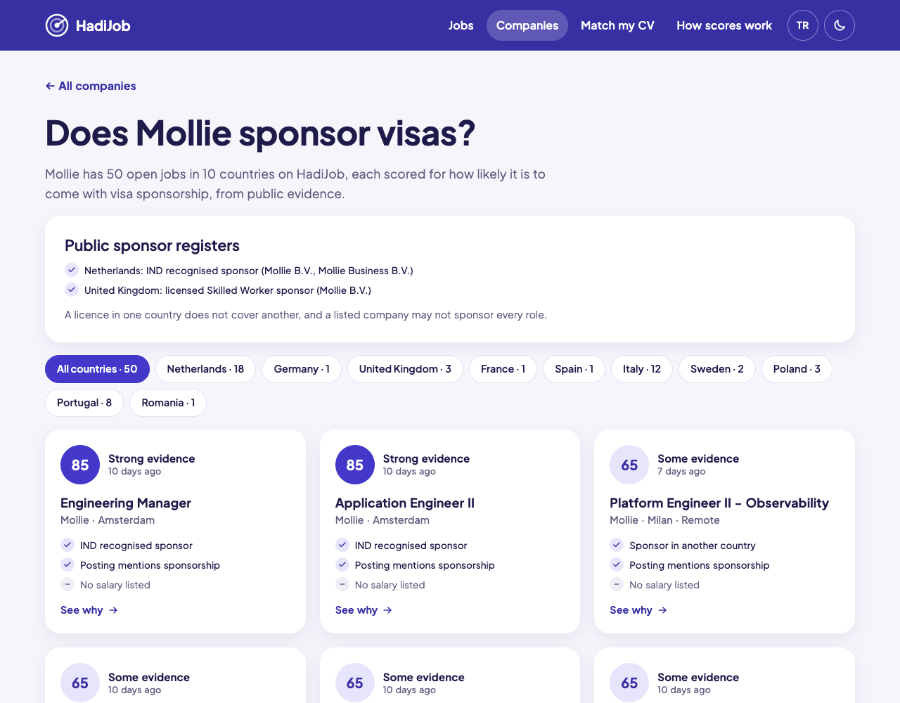
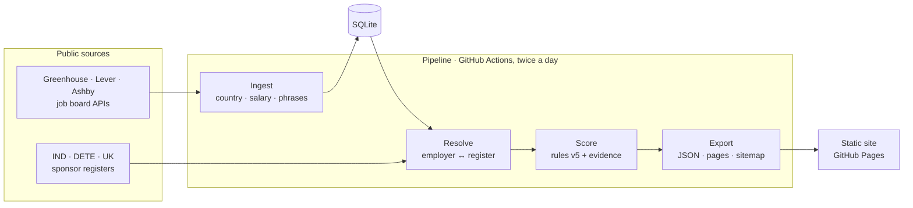

# HadiJob

### Stop applying to jobs that won't sponsor your visa.

HadiJob scores **5,600+ open jobs across Europe** for how likely they are to come with visa sponsorship. It uses government sponsor registers and the posting itself, and shows you **the proof behind every point**. 
Free, no sign-up, in English and Turkish.

**[Find sponsoring jobs at hadijob.com →](https://hadijob.com/)**

Testing phase: feedback is very welcome.

<picture>
  <source media="(prefers-color-scheme: dark)" srcset=".github/assets/home-dark.png">
  
</picture>

**5,689 jobs** · **21 countries + Europe-wide remote** · **145 employers** · **3 government sponsor registers** · **updated twice a day**

> [!NOTE]
> This repository is a showcase. The source code is private; I'm happy to walk through it in an interview or share it on request.

## Why HadiJob

If you need a visa, most of your applications go to roles that were never going to sponsor you. Job boards don't say, and employers' own wording is vague.

HadiJob checks **public evidence** instead and turns it into a score you can read in a second and verify in a click:

- 🏛️ **Is the employer a licensed sponsor?** Checked against the Dutch IND register, Ireland's employment-permit statistics and the UK register of licensed sponsors.
- 📝 **What does the posting say?** It picks up "visa sponsorship" and "relocation package", and also "you must already have the right to work".
- 💶 **Does the salary clear the permit threshold?** Compared with 2026 work-permit minimums in each country's own currency.

## What you can do

**Find**

- **Search 21 countries at once,** the EU only, one country, or **Europe-wide** remote roles. Filter by **category** (Engineering, Data, Sales, Marketing and more), evidence strength, posting date and remote.
- **See what's new since your last visit.** New jobs are marked, and one switch shows only those. The date stays in your browser.
- **Share any search.** Every filter lives in the link.

**Understand**

- **Every point has a reason.** "IND recognised sponsor +40", "posting mentions a relocation package +30", "salary ≥ Blue Card threshold +15". No black box.
- **"Does this company sponsor visas?"** Each employer has its own page in the app, with the registers that list it and its scored jobs, filterable by country.

**Personalise**

- **Match your CV, privately.** Drop in a PDF CV: it's read in your browser and never uploaded. Jobs are then ranked by how many of your skills they ask for.
- **English or Turkish,** light or dark. Both follow your device, and you can switch either in the header.

## 🇹🇷 Türkçe

HadiJob, Avrupa'daki 5.600'den fazla açık ilanı vize sponsorluğu olasılığına göre puanlar. Hollanda, İrlanda ve Birleşik Krallık'ın resmî sponsor kayıtlarına ve ilanın kendisine bakar, her puanın kanıtını da gösterir. Ücretsiz, üyelik yok, tamamen Türkçe: **[hadijob.com](https://hadijob.com/)**

## How it works

1. **Ingest:** 145 company job boards are fetched politely. Each job's facts (country, remote, salary, language, sponsorship phrases) are extracted while the text is in memory. Descriptions are never stored.
2. **Resolve:** each employer is matched to the three registers. Exact names link automatically, near-matches go to human review, and every decision is kept in version control.
3. **Score:** versioned, explainable rules. A score starts at 0, adds each signal's weight and is clamped to 0–100.
4. **Export:** one JSON file per country for the site, plus about 320 pre-built company and country pages in both languages.

The whole thing runs for **€0**: no servers and no database server, with the SQLite file kept between runs as a release asset.

### Scoring rules (v5)

| Signal                                                                           | Weight  |
| -------------------------------------------------------------------------------- | ------- |
| Employer is on the country's sponsor register (IND for NL · DETE for IE · UK)    | **+40** |
| Posting mentions visa sponsorship, relocation or the EU Blue Card                | **+30** |
| Employer is a registered sponsor in another country (countries with no register) | **+20** |
| Salary ≥ the country's work-permit threshold (e.g. DE €45,934 · UK £41,700)      | **+15** |
| Large employer (≥ 50 open jobs in ≥ 2 countries)                                 | **+10** |
| English posting in a country where English isn't the main language               | **+5**  |
| Posting rules out sponsorship, or requires an existing right to work             | **−60** |

Scores are **likelihoods, not guarantees and not legal advice**. Always confirm with the employer.

## By the numbers

From the live data on 2026-11-11:

|                                    |                                                                                       |
| ---------------------------------- | ------------------------------------------------------------------------------------- |
| Published jobs                     | **5,689** in 21 countries + 181 Europe-wide (DE 1,536 · GB 1,254 · NL 624 · IE 445 …) |
| Open jobs processed                | **16,343** from **145** job boards (Greenhouse 77 · Ashby 56 · Lever 12)              |
| Jobs with register evidence        | **NL 581 of 624 · GB 1,083 of 1,254 · IE 320 of 445**                                 |
| Sponsor registers                  | **13,087** IND sponsors · **121,488** UK sponsors · **9,430** Irish permit holders    |
| Employers with sponsor evidence    | **87** of 145                                                                         |
| Company matching (automatic rules) | **100% precision · 81.8% recall** on 100 hand-labelled pairs                          |
| Duplicate postings folded          | **1,266** into 705 roles                                                              |
| Full refresh of all boards         | **75 s** (down from 37 min)                                                           |
| Tests                              | **510**, plus an offline end-to-end smoke test of the whole pipeline                  |

## Engineering highlights

- **37 minutes to 75 seconds.** Timing each board showed the time wasn't spent downloading: a few connections stalled for about 15 minutes each (3 attempts × a 300 s default timeout). A 30 s per-attempt timeout fixed the cause, and polling the three API hosts in parallel (still one request per second per host) removed the rest.
- **Precision first.** Company matching only auto-links exact names; everything else needs a recorded human decision. On 100 hand-labelled pairs, including 45 deliberate look-alikes (Toast vs. "Yoast B.V."), the rules scored 100% precision.
- **Two pieces of evidence for the UK.** On the UK register's 121,000 names, exact-name matching produced 2 false links out of 17 ("Cursor Ltd" in Lincoln is not Cursor). A UK entry now links only when the name matches _and_ a register town is a city where the company hires: 100% precision on 37 labelled pairs, tested in CI.
- **Growing the employer list from the registers.** The registers double as a list of companies known to sponsor. A pilot probed 2,417 register names against three job-board APIs, measured the hit rate per register (0.9% for Dutch sponsors, against 0.3% for Irish permit holders), and kept only boards verified by hand.
- **Checked against reality.** Running each extractor on live postings caught false positives the unit tests didn't, such as "deals of £100k+ ACV" read as a salary, or "Visa sponsorship is not offered" counted as a mention. Every one became a regression test.
- **Search engines without a server.** The app uses hash routes, which search engines can't index, so the build pre-renders about 320 company and country pages with `react-dom/server`, in English and Turkish with `hreflang`, plus a sitemap.
- **Privacy by architecture.** CV matching runs entirely in the browser with pdf.js and a skill taxonomy. "New since your last visit" stores just a date in the browser. There are no accounts, cookies or trackers.
- **Hardened by default.** A strict Content-Security-Policy, where the only inline script is allowed by its SHA-256 hash. GitHub Actions are pinned to commit SHAs, with weekly Dependabot updates, dependency review and CodeQL on every pull request.
- **Runtime-agnostic core and validated boundaries.** The core uses only web-platform APIs and is shared with a Fastify API, and every external response is parsed with Zod. A changed API shape fails loudly for that board, and one bad link drops that job, not the whole board.
- **A government spreadsheet without a dependency.** The Irish permits list is an XLSX file whose layout changes every year. A ~100-line reader unzips it with the web-standard `DecompressionStream` and fails loudly on a changed layout instead of silently dropping employers.
- **Decisions on record.** Every architectural choice is written down as a decision record (32 so far), and all work goes through small, CI-gated pull requests.

## Tech stack

| Area       | Choice                                                                                     |
| ---------- | ------------------------------------------------------------------------------------------ |
| Language   | TypeScript (strict) on Node 24, run directly without a build step                          |
| Monorepo   | pnpm workspaces: core logic, pipeline, web, API                                            |
| Data       | SQLite via `node:sqlite`, Zod at every boundary                                            |
| Web        | React 19 + Vite, plain CSS with design tokens, pre-rendered SEO pages, English and Turkish |
| API (v1)   | Fastify, Kysely + Postgres, Testcontainers. Built and tested, not deployed yet             |
| Testing    | Vitest, Testing Library, jsdom: 510 tests, plus an offline end-to-end smoke test           |
| Automation | GitHub Actions: CI on every PR, pipeline twice a day and on merge, deploy to GitHub Pages  |

## Data sources and ethics

- **Public, keyless sources only:** the Greenhouse, Lever and Ashby job board APIs, the IND public register, the Irish DETE permit statistics and the UK register of licensed sponsors. No LinkedIn or Indeed, and no scraping behind logins.
- **Metadata plus a link out.** Full job descriptions are never stored or republished.
- **Attribution** on every piece of evidence, as the registers' reuse terms require.
- **Corrections and removal on request,** through the [correction form](https://github.com/ilker-ekin/hadijob/issues/new/choose).

## Roadmap

**Done**

- [x] Explainable scores from three government sponsor registers, the posting and the salary
- [x] 21 countries plus Europe-wide remote roles, searchable together, by country or EU only
- [x] Every kind of role, not only tech, with a category filter
- [x] Evidence across borders: a sponsor in one country counts, at half weight, where there's no register
- [x] Company and country pages that search engines can index, in English and Turkish
- [x] "New since your last visit", kept only in your browser
- [x] CV matching in the browser
- [x] English and Turkish, light and dark, on its own domain

**Next**

- [ ] More employers: probing the rest of the Dutch sponsor register (about 12,000 names; running now)
- [ ] Public launch: a security review, then opening the site to search engines
- [ ] Deploy the search API on AWS Lambda + Neon (still €0, still no accounts)
- [ ] A public stats page with privacy-first visitor counts: no cookies, bots filtered

## License

© 2026 İlker Ekin Erdoğdu. All rights reserved. This showcase (text and images) may not be reused without permission.
